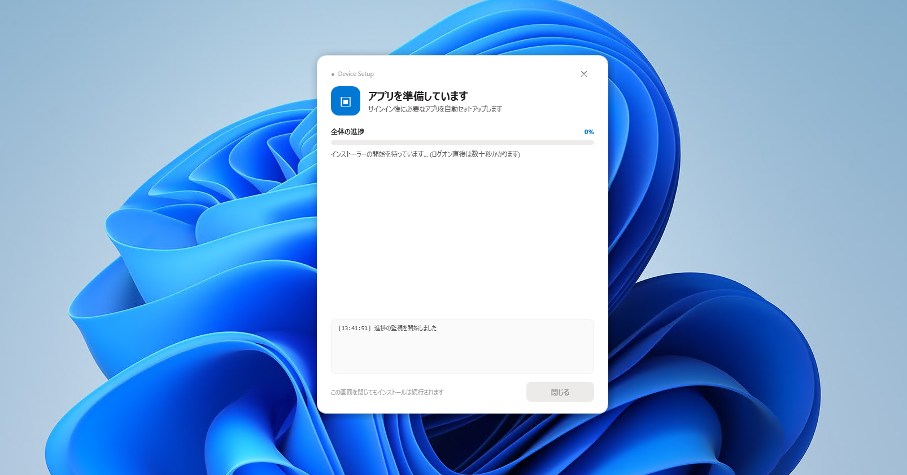

# Winstallomator — Windows アプリケーション セットアップマネージャー

WinstallomatorはAutopilotで展開されるデバイスへのアプリケーションインストールを支援するスクリプトです。

AutopilotのEnrollment Status Page (ESP:登録状態ページ) 中はアプリ配布をせず、
ESP完了後の初回ログオンでダウンロード＋インストールすることで、煩雑なアプリケーション管理から解放されると共に、最速でデスクトップ到達を目指し、最良のユーザ体験を提供するための仕組みです。



## ファイル構成

| ファイル | 実行コンテキスト | 役割 |
|---|---|---|
| `Deploy-Provisioning.ps1` | SYSTEM | ペイロード配置＋予定タスク2本登録 |
| `Install-Apps.ps1` | SYSTEM | `apps.json` 順に DL→サイレントインストール |
| `Show-Progress.ps1` | ログオンユーザー（ログオン後） | `status.json` をポーリングして進捗 GUI を表示するだけ |
| `apps.json` | - | 導入対象アプリカタログ |

実行時データ（`C:\ProgramData\AppProvisioning\`）：

- `payload/` — 上記3ファイルの配布コピー（タスクはここを参照）
- `downloads/` — インストーラ DL 先
- `logs/` — `setup.log` / `installer.log` / MSI 個別ログ
- `status.json` — 進捗の中継ファイル（裏→表の唯一の連携手段）
- `done.flag` — 完了マーカー

## 全体の流れ

```
ESP デバイスセットアップ中 (SYSTEM, ログオン前)
  Deploy-Provisioning.ps1
    └→ C:\ProgramData\AppProvisioning に配置 + status.json 初期化(Pending)
    └→ タスクスケジューラ登録: AppProvision-Install (SYSTEM/AtLogOn, Delay 1分)
                             AppProvision-Progress (Users/AtLogOn, Delay 30秒)

初回サインイン → デスクトップ到達
  約30秒後: Show-Progress.ps1 が起動 (ユーザー権限で GUI 表示)
  約1分後 : Install-Apps.ps1 が起動 (SYSTEM で DL + インストール)
    └→ 進捗を status.json に書く → GUI が 700ms ポーリングで反映

全成功時: done.flag 作成 + 両タスク自己削除 (次回ログオンでは何も起きない)
一部失敗時: state=Error でタスクは残る (次回ログオンで再試行)
```

## `apps.json` リファレンス

```json
{
  "internetWaitSeconds": 600,
  "apps": [
    {
      "name": "7-Zip 26.03 (64-bit)",
      "url": "https://github.com/.../7z2603-x64.msi",
      "fallbackUrl": "https://www.7-zip.org/a/7z2301-x64.msi",
      "fileName": "7z2603-x64.msi",
      "installer": "msi",
      "silentArgs": "/qn /norestart",
      "detectionPath": "C:\\Program Files\\7-Zip\\7z.exe"
    }
  ]
}
```

- `installer`: `msi`（`msiexec /i`）か `exe`（直接実行）。`fileName` の拡張子でも判定する
- `silentArgs`: サイレント引数（msi は `/qn /norestart` 推奨）
- `detectionPath`: 存在すればスキップ（`Skipped`）扱い。再実行の冪等性用
- `fallbackUrl`: 省略可。第1 URL 失敗時のみ試す
- アプリ追加は配列に追記するだけ。スクリプト改修不要

## `status.json` 状態遷移

- 全体 `state`: `Running` → `Complete` / `Error`
- アプリ毎 `status`: `Pending` → `Downloading` → `Installing` → `Installed`
  ／ `Skipped`（検出済み）／ `Failed`（エラー内容は `error` に格納）
- `overallPercent`: 完了数＋進行中％から算出
- 書き込みは `.tmp` 経由の置換（アトミック）なので GUI 側が半端 JSON を読まない

## ローカルテスト方法

スケジューラなし（2窓並走）：

```powershell
# 窓B (ユーザー権限): GUI 先行起動
powershell -NoProfile -ExecutionPolicy Bypass -File ".\Show-Progress.ps1"
# 窓A (管理者): 本体起動
powershell -NoProfile -ExecutionPolicy Bypass -File ".\Install-Apps.ps1"
```

スケジューラあり（本番相当）：

```powershell
# 管理者窓
.\Deploy-Provisioning.ps1 -NoDelay
Get-ScheduledTask -TaskName 'AppProvision-*'   # 2件確認
# サインアウト→サインイン
.\Deploy-Provisioning.ps1 -Cleanup             # 後片付け
```

GUI だけ試す場合は `status.json` を手書きして `Show-Progress.ps1` を起動すればよい。

## Intune 登録

1. パッケージ化：

```powershell
IntuneWinAppUtil.exe -c ".\app-provisioning" -s Deploy-Provisioning.ps1 -o C:\Temp\IntuneOut
```

2. 登録値（デバイス ＞ アプリ ＞ Windows ＞ Windowsアプリ(Win32)）：

- インストール: `powershell.exe -NoProfile -ExecutionPolicy Bypass -File ".\Deploy-Provisioning.ps1"`
- アンインストール: `powershell.exe -NoProfile -ExecutionPolicy Bypass -File ".\Deploy-Provisioning.ps1" -Cleanup`
- 動作: システム／再起動動作なし。要件: Win10 21H2 以降・64-bit
- 検出規則: ファイル `C:\ProgramData\AppProvisioning\payload\apps.json` が存在する
- 割り当て: Autopilot 対象デバイスグループに必須

3. アプリ追加時：`apps.json` 追記→再パッケージ→同アプリを上書き更新。